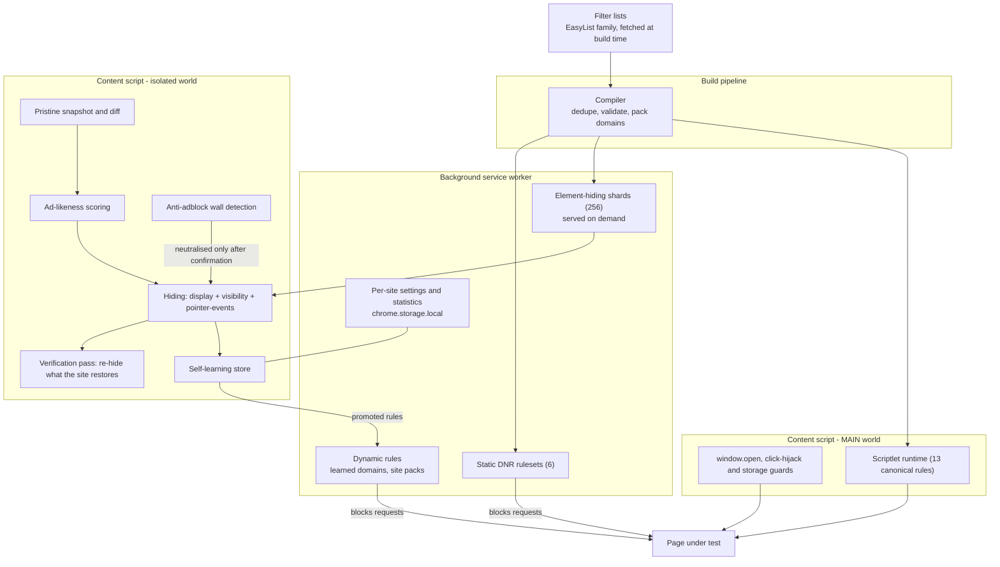
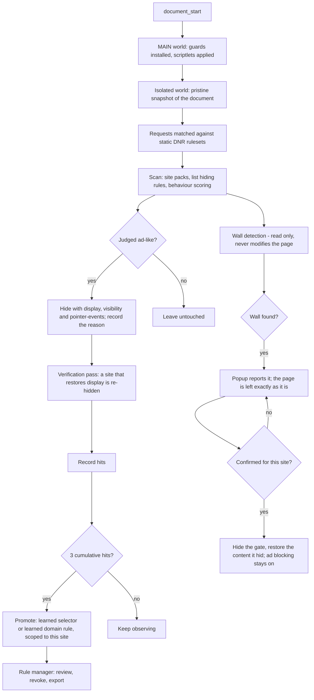

<div align="center">


# AdBlow

**An ad blocker that judges elements by their behaviour at runtime, not only by matching filter lists.**

[](#)
[](#testing--verification)
[](#user-interface)

[中文说明](README.zh-CN.md)

</div>

---

## What it is

AdBlow is an ad blocker for Microsoft Edge and Google Chrome, built on Manifest V3. The filtering
engine, the user interface and the build toolchain are all implemented from scratch.

Alongside the rule matching provided by the EasyList family of filter lists, the extension runs a
runtime judgement stage that evaluates each element on its behaviour. It looks for elements
injected into the page by script rather than present in the document, media served from a domain
that appears nowhere else on the page, abnormal growth in geometry, links routed through a
redirect endpoint on the site's own domain, and images proxied through a base64 path on a CDN. Ads
of this kind rarely appear in filter lists, but they leave observable behaviour behind.

## Design trade-offs

**Judgement is not limited to filter lists.** The common approach matches requests and selectors
against rules, and anything the lists have not seen passes through. AdBlow adds runtime
observation on top of that, covering two widespread evasion techniques: rewriting an ad link into
a redirect endpoint on the site's own domain, with a payload that declares `{"kind":"ad", ...}`,
and wrapping the real media address in base64 inside a path served by the site's own CDN. Both are
unwrapped to the real address first, and the decision is then made on that address.

**A false positive costs more than a miss.** Every rule produced by self-learning is scoped to the
site that produced it, can be revoked individually, and by construction never applies to images,
media, scripts or stylesheets. The trade-off is stated explicitly:

> Better to miss an ad than to break a page.

Unlike AdBlock Plus and similar products, AdBlow has no paid "Acceptable Ads" whitelist, and it
does not unblock advertising in exchange for payment. The build refuses to fetch a list that
carries one.

## How it compares

Only the dimensions this project's positioning depends on are listed; this is not a full
evaluation. AdBlock Plus, AdGuard and uBlock Origin each lead on something AdBlow does not
(AdGuard's product breadth, uBlock Origin's filter-syntax coverage, AdBlock Plus's platform and
language reach). Compiled from public documentation in October 2026; corrections are welcome.

| | **AdBlow** | AdBlock Plus | AdGuard | uBlock Origin |
|---|---|---|---|---|
| EasyList-family filter lists | yes | yes | yes (plus its own) | yes |
| Paid "Acceptable Ads" whitelist | **none** | yes, on by default | none | none |
| Judgement by runtime behaviour (not just list matching) | **yes**: cross-site media, geometry growth, own-domain redirect unwrapping, base64 CDN unwrapping | no | no | no |
| Self-learning per site, revocable entry by entry, scoped to the site that taught it | **yes** | no | no | no |
| Anti-adblock walls | detected; neutralised per site **after the user confirms it**, ad blocking kept | filter lists | annoyance filters, automatic | annoyance filters and scriptlets, automatic |
| Filter-list updates | with the extension version (MV3 static rulesets) | runtime updates | runtime updates | full version: runtime updates; MV3 (uBO Lite): with the version |
| Manifest V3 | native | MV3 build available | MV3 build available | MV3 is the reduced uBO Lite |
| UI languages | 5 | dozens | dozens | dozens |
| Price and licence | free; project GPL-3.0, code also MIT | free (GPLv3) | extension free, desktop apps paid | free (GPLv3) |

## Features

### Network layer

6 filter lists (EasyList, EasyList China, EasyPrivacy, uBlock filters / privacy / badware)
compiled into declarativeNetRequest rulesets. 127,336 input rules are deduplicated and validated
down to 21,146 block rules and 2,369 exceptions across 6 rulesets, with 105,675 domain anchors
collapsed into 113 rules.

### Element hiding

25,478 domain-specific selectors covering 11,389 domains, split into 256 hash shards and requested
by the content script on demand. The extension does not use `web_accessible_resources`, which
leaves one less surface available for detection.

### Behaviour engine

A diff against a pristine snapshot taken early in page load, plus an ad-likeness score per
element. Signals include script injection, cross-site links and media, cross-site iframes, growth
in geometry, promo query parameters, ad naming across three confidence tiers, full-screen
overlays, click layers, fake close buttons and link farms. A match records
`data-adblow-reason` and `data-adblow-why`, so triaging a false positive can be traced directly to
the mechanism and the evidence behind it.

### Anti-hijack guards

Four behaviours are restricted in the page's MAIN world: `window.open` calls, click hijacking,
popup-state writes to `localStorage`, `sessionStorage` and `window.name`, and document-level click
handlers that only perform navigation.

### Anti-adblock walls

When a site measures a bait element to detect a blocker and then gates the page behind an
ad-blocker notice, the popup offers a per-site fix. Nothing changes until that is accepted: the fix
hides the gate, restores the article content the gate hid, and leaves ad blocking in place, so the
page becomes readable without letting the ads back in. Detection runs regardless, so the popup can
report a wall even before anything is done about it.

### Scriptlet support

13 canonical `##+js(...)` scriptlets (`abort-on-property-read`, `set-constant`, `json-prune`,
`abort-current-script`, `no-fetch-if`, `no-setTimeout-if` and others) covering 3,246 domains. The
data table is inlined in the script so that it takes effect before page scripts run.

### Self-learning

Hiding selectors and ad domains are recorded per site, and become active after 3 cumulative hits.
Every entry is listed in the rule manager, and can be deleted individually or exported as JSON.

### Per-site switch

The popup provides a filtering switch for the current site. Turning it off also suspends the
learned network rules that are active for that site.

### User interface

Chinese (simplified, default), English, Japanese, French and Spanish, selected automatically from
the browser UI language.

### Privacy

All processing is local. There is no telemetry, no account and no remote configuration; apart from
the browser updating the extension itself, no outbound requests are made.

## Screenshots

| Popup (site switch + live stats) | Rule manager |
|---|---|
|  |  |

## Install

The extension can currently be built and installed from source:

```bash
git clone <this repo> && cd adblow
pnpm install
pnpm filters        # fetch the 6 filter lists (not in the repo, see Licensing)
pnpm rulesets       # compile them into DNR rulesets, hiding shards and the scriptlet table
pnpm build          # -> dist/
```

Then enable Developer mode in `edge://extensions` (or `chrome://extensions`) and choose **Load
unpacked**, pointing at the `dist/` directory.

The store package is produced by `pnpm package` (`release/adblow-1.0.1-edge.zip`); v1.0.0 is already
listed on the Edge Add-ons store.

## Build and package

```bash
pnpm test           # 689 unit and integration tests, run in-process
pnpm typecheck      # tsc --noEmit
pnpm verify         # build + tests
pnpm icons          # regenerate icons (16/32/48/128 and the store icon)
pnpm package        # build + audit + zip -> release/adblow-<version>-edge.zip
pnpm update-lists   # refresh the filter lists and rebuild everything
```

Node.js 24 or later and pnpm are required; generating icons and store screenshots additionally
needs Python 3 with Pillow.

Filter lists are compiled into static rulesets at build time, and MV3 offers no way to replace a
static ruleset remotely, so the freshness of the lists is bound to the release frequency:
refreshing the lists means shipping a new version. The rule manager displays the fetch date of the
bundled lists. The trade-offs between periodic releases and runtime incremental updates, together
with the measured quota figures, are documented in
[filter list updates](docs/LIST-UPDATES.md) (Chinese).

The packaging step checks the file list in `dist/` against the resources the manifest actually
declares and removes anything that is not a product file, such as the browser-generated
`_metadata/` ruleset index cache. It writes a zip with `manifest.json` at its root. If a browser
currently has `dist/` loaded, Windows locks the directory; build into a different directory rather
than terminating the browser:

```bash
ADBLOW_DIST=dist-release pnpm package
```

## Project layout

The implementation is divided into four layers, each narrowing the scope and privileges of the
one above it:

| Layer | Runs in | Responsibility | Why it exists |
|---|---|---|---|
| **Network** | `declarativeNetRequest` | Static rulesets compiled from filter lists, plus dynamic rules for learned domains | Blocks requests before they are sent |
| **Element hiding** | Isolated world | Domain-scoped CSS, and inline `!important` hiding for matched elements | Keeps content that should not render out of the rendering path |
| **Behaviour** | Isolated world | Pristine snapshot diff, ad-likeness scoring, self-learning | Covers ads that filter lists have not recorded yet |
| **Anti-hijack** | MAIN world | `window.open`, click hijacking, storage writes, event listeners | Prevents the page from interfering with filtering |

```
src/
  background/      service worker: DNR sync, hiding-shard delivery, statistics
  content/         element hiding and behaviour: engine, judgement, learned-rule store, site settings
  inject/          anti-hijack: MAIN-world restrictions and the scriptlet runtime
  engine/          browser-free logic: scoring, lexicon, geometry, DNR, filter-list compiler,
                   scriptlet parser, selector generalisation
  rules/sites/     hand-written site packs (per-site, verified selectors)
  ui/              popup, rule manager, i18n
tools/
  filters/         filter-list fetching (lists with paid whitelists are rejected)
  build/           ruleset, hiding-shard and scriptlet codegen; packaging; icon generation
  e2e/             24-category acceptance suite in a real browser; live-site end-to-end
  release/         audit, zip packaging, store screenshot generation
  diagnostics/     console snippets for locating the cause of a broken page
tests/             689 unit and integration tests (jsdom)
public/            manifest, _locales, icons
```

### Architecture



### Request and judgement flow



## Safety invariants

Every constraint below is enforced in code and covered by tests. Each one corresponds to a false
positive that actually shipped:

- Learned network rules never apply to `image`, `media`, `script`, `stylesheet` or `font`. Content
  thumbnails and ad creatives frequently share one CDN, and blocking it takes down every image on
  the site.
- Learned rules apply only to the site that produced them (`initiatorDomains`); a domain learned
  on site A cannot affect site B.
- Implicit rules never block a `main_frame`; only an explicit `$document` rule may do so.
- `html`, `body` and `head` are never hidden. Hiding them blanks the page.
- A page-level hiding budget limits the proportion of text and links that may be hidden, and
  elements carrying body content or navigation are exempt.
- Hiding sets `display`, `visibility` and `pointer-events` together, and re-checks afterwards.
  Sites do re-assert `display` with their own `!important`; the 1024cg case was found by that
  re-check.

## Testing & verification

```bash
node tests/run-all.ts           # 689 tests, 0 failures
node tools/e2e/acceptance.mjs   # 24 ad categories, measured in a real browser
```

`tools/e2e/acceptance.mjs` is the main acceptance suite. It builds a realistic page for each of 24
categories of ad interference, covering pop-ups, pop-unders, interstitials, floating bars, corner
widgets, sticky banners, outstream video, preroll, mid-roll, video overlays, full-page clickable
ads, fake close buttons, click hijacking, tab-under, region expanders, flashing GIFs, rich media,
own-domain redirect wrapping and base64 CDN wrapping, among others.

Every fixture is measured twice. First with the extension disabled, to establish a baseline: if
the ad does not actually interfere in the baseline, the fixture is rejected and has to be rebuilt.
Then with the extension enabled: the ad must be gone, and the real content of the fixture must
still be visible.

A live-site end-to-end run (`tools/e2e/run.mjs <url>`) covers the same ground against a real page,
with image guards, CDN guards and site-owned-domain guards. A regression that removes an ad but
starts hiding body content therefore fails during testing instead of reaching a release.

## Known limitations

- Generic (non-domain-specific) hiding rules are not injected; only domain-scoped rules are.
- Procedural cosmetic filters (`#?#`) and HTML filtering (`##^`) are not implemented.
- `abort-current-script` is supported only when the rule carries a search needle, so that the trap
  aborts the offending script and passes every other reader through untouched. 38 rules in the
  lists have no needle and are dropped. The remaining unimplemented scriptlets
  (`abort-on-stack-trace`, `remove-node-text`, `nano-setTimeout-booster`, `nowebrtc`, `noeval` and
  others) account for 385 rules. The build reports what it skips instead of widening a rule to
  include more.
- Anti-adblock walls (a site measuring a bait element, then gating the page) are handled only after
  an explicit per-site confirmation. The popup offers to hide the gate and restore the content it
  hid, while ad blocking stays on; nothing changes on a site until that is accepted, and the choice
  can be undone.
- Filter lists are compiled at build time, so updating them requires rebuilding the extension.
  This is an MV3 constraint: remote rulesets are not supported.
- No public performance benchmarks yet, and no like-for-like comparison against other blockers on
  neutral sites.

## Third-party components and licenses

Filter lists are maintained by their respective authors, are not part of this repository, and are
fetched during the build:

| List | License |
|---|---|
| [EasyList](https://easylist.to/), [EasyList China](https://easylist.to/), [EasyPrivacy](https://easylist.to/) | GPL-3.0 / CC BY-SA 3.0 |
| [uBlock Origin assets](https://github.com/uBlockOrigin/uAssets) (filters, privacy, badware) | GPL-3.0 |

Redistributing any artifact built from this repository requires compliance with those licenses.

## License

The project as a whole is distributed under **GPL-3.0**; the full text is in [LICENSE](LICENSE).
The original source code in this repository is additionally offered under **MIT**, in
[LICENSE-MIT](LICENSE-MIT), so that code may be reused under MIT terms.

The reason for two layers: a built extension embeds the GPL-3.0 / CC BY-SA filter data listed
above, and that part cannot be relicensed under MIT, which is what makes the whole distribution
GPL-3.0. The code implemented here (engine, UI, build and release tooling, tests) is unaffected,
so it carries a permissive MIT grant as well.

The third-party filter lists are not part of this repository; they are fetched during the build and
keep their own licenses.

---

<div align="center">
<sub>AdBlow 1.0.1 · Manifest V3 · Edge &amp; Chrome</sub>
</div>
