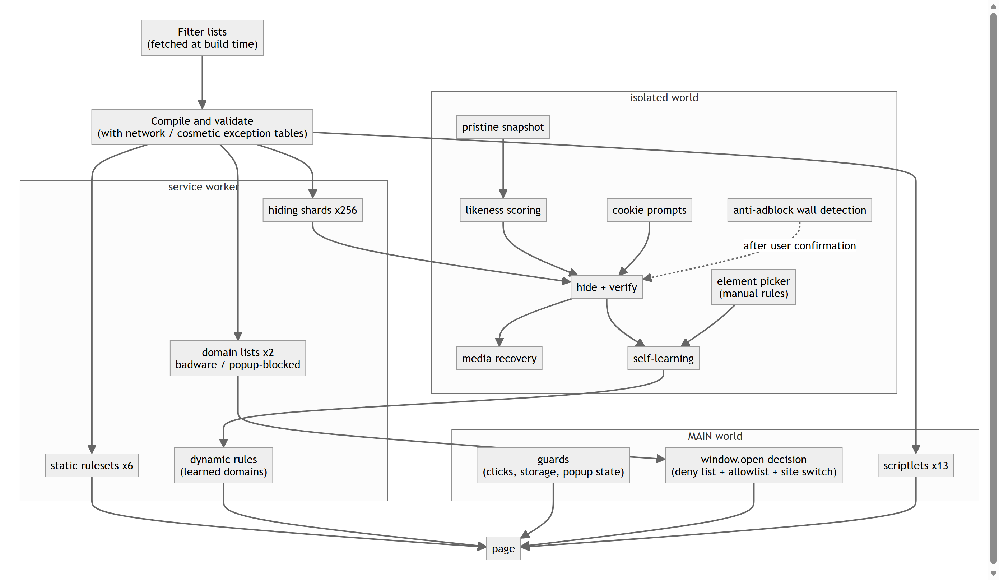
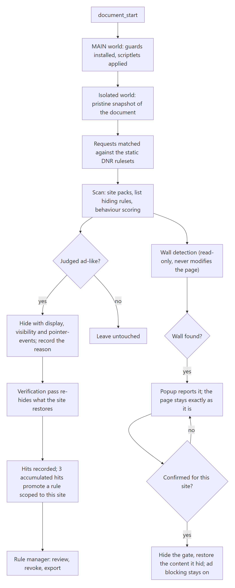

<div align="center">


# AdBlow

**An ad blocker that judges elements by their behaviour at runtime, not only by matching filter lists.**

[](#)
[](#testing--verification)
[](#user-interface)
[](https://github.com/jfxia/AdBlow/actions/workflows/ci.yml)
[](https://github.com/jfxia/AdBlow/actions/workflows/auto-release.yml)

[中文说明](README.zh-CN.md)

</div>

---

## What it is

Most ad blockers have the same shape: a rule list that someone maintains, plus an engine that applies it.
A request that matches an entry is blocked; an element that matches a selector is hidden. The approach
works, and it has a blind spot by construction: as soon as an ad changes its face, it is no longer in
the list.

The usual ways of changing face are: a script builds an overlay after load; the creative is served from
a domain that appears nowhere else on the page; an element renders normally and then grows to fill the
screen; the click is routed through the site's own endpoint, so nothing outside looks like an ad; the
image address is hidden in a base64 CDN path. None of them appears in any list, so a list-only blocker
cannot catch them.

AdBlow judges differently: it does not look at what an ad looks like, but at what it did in the page.
It still applies the EasyList family of lists, and on top of that watches each element at runtime:
whether the element was built by script, where its media comes from, whether it grew abnormally, where
its links point. It decides from that. The filtering engine, the user interface and the build toolchain
are all implemented from scratch.

In the implementation those trade-offs are concrete: all judgement happens locally, with no telemetry, no account and no remote configuration; there is no paid whitelist, so no channel exists for paying an ad through; and a rule produced by self-learning applies only on the site that taught it, and can be revoked entry by entry.

## Design trade-offs

**Judgement is not limited to filter lists.** Two of the techniques the runtime stage looks for need
unwrapping before they can be judged: an ad link rewritten into a redirect endpoint on the site's own
domain, with a payload that declares `{"kind":"ad", ...}`, and a real media address wrapped in base64
inside a path served by the site's own CDN. In both cases the ad looks exactly like a same-site link
or a same-site asset from the outside, so AdBlow unwraps the real address first and decides on that.

**A false positive costs more than a miss.** Every rule produced by self-learning is scoped to the
site that produced it, can be revoked individually, and by construction never applies to images,
media, scripts or stylesheets. The trade-off is stated explicitly:

> Better to miss an ad than to break a page.

The same principle has a less visible side: no paid unblocking. AdBlock Plus ships "Acceptable Ads"
on by default and lets advertisers pay to pass; AdBlow has no such whitelist, and the build refuses
to fetch a list that carries one. The reason is the same as above: a blocker that can sell an
exemption is no longer judging only by whether something looks like an ad.

## Architecture



## Request and judgement flow



## How it compares

Only the dimensions this project's positioning depends on are listed; this is not a full
evaluation. AdBlock Plus, AdGuard and uBlock Origin each lead on something AdBlow does not
(AdGuard's product breadth, uBlock Origin's filter-syntax coverage). Compiled from public
documentation in October 2026; corrections are welcome.

| | **AdBlow** | AdBlock Plus | AdGuard | uBlock Origin |
|---|---|---|---|---|
| EasyList-family filter lists | yes | yes | yes (plus its own) | yes |
| Paid "Acceptable Ads" whitelist | **none** | yes, on by default | none | none |
| Judgement by runtime behaviour (not just list matching) | **yes**: cross-site media, geometry growth, own-domain redirect unwrapping, base64 CDN unwrapping | no | no | no |
| Self-learning per site, revocable entry by entry, scoped to the site that taught it | **yes** | no | no | no |
| Anti-adblock walls | detected; neutralised per site **after the user confirms it**, ad blocking kept | filter lists | annoyance filters, automatic | annoyance filters and scriptlets, automatic |
| Filter-list updates | with the extension version (MV3 static rulesets) | runtime updates | runtime updates | full version: runtime updates; MV3 (uBO Lite): with the version |
| Price and licence | free; project GPL-3.0, code also MIT | free (GPLv3) | extension free, desktop apps paid | free (GPLv3) |

## Features

### Network layer

AdBlow compiles six filter lists (EasyList, EasyList China, EasyPrivacy, and uBlock's filters,
privacy and badware) into declarativeNetRequest rulesets at build time. Of 128,023 input rules,
deduplication and validation keep 20,913 block rules and 2,365 exceptions across six rulesets.
106,595 domain anchors are collapsed into 114 rules: kept one per domain, the anchors would both
inflate the package and reach the browser's static-rule ceiling sooner.

### Element hiding

AdBlow ships 25,467 domain-scoped selectors covering 11,357 domains. Fitting that table into every
tab is not practical, so the rules are hashed into 256 shards and the content script asks the
background worker only for the shards its site falls in. The extension declares no
`web_accessible_resources`, so page scripts cannot enumerate the shard addresses and fewer
internal interfaces can be probed.

### Behaviour engine

The content script records a pristine snapshot early in page load and diffs against it, then scores
each element for ad likeness. The snapshot is there for one reason: once the page has loaded,
"content the page shipped" and "nodes a script added later" look identical in the DOM, and only the
diff separates them. That is what the script-injected signal is measured from. The signals are:
whether the element was script-injected, whether it
carries cross-site links or media, whether it holds a cross-site iframe, whether it grew
unexpectedly, whether its links carry promo parameters, where its naming falls across three
confidence tiers, and whether it forms a full-screen overlay, a click layer, a fake close button or
a link farm. A match writes `data-adblow-reason` and `data-adblow-why`, so triaging a false
positive leads straight to the mechanism and the evidence behind it.

### Anti-hijack guards

Page scripts can interfere with filtering as well, so AdBlow restricts four behaviours in the
page's MAIN world: `window.open` calls, click hijacking, popup-state writes to `localStorage`,
`sessionStorage` and `window.name`, and document-level click handlers that only perform
navigation.

### Anti-adblock walls

When a site measures a bait element to detect a blocker and then gates the page behind an
ad-blocker notice, the popup offers a per-site fix. Nothing changes until that is accepted: the fix
hides the gate, restores the article content the gate hid, and leaves ad blocking in place, so the
page becomes readable without letting the ads back in. Detection runs regardless, so the popup can
report a wall even before anything is done about it.

### Scriptlet support

13 canonical `##+js(...)` scriptlets (`abort-on-property-read`, `set-constant`, `json-prune`,
`abort-current-script`, `no-fetch-if`, `no-setTimeout-if` and others) covering 3,247 domains. The
data table is inlined in the script so that it takes effect before page scripts run.

### Self-learning

Hiding selectors and ad domains are recorded per site and become active only after 3 cumulative
hits. One hit can be a page that merely looks ad-like; a rule is worth keeping once it repeats. Even
then it applies only on the site that taught it, and can be revoked at any time. Every entry is
listed in the rule manager, and can be deleted individually or exported as JSON.

### Per-site switch

The popup provides a filtering switch for the current site. Turning it off also suspends the
learned network rules that are active for that site.

### User interface

Chinese (simplified, default), English, Japanese, French and Spanish, selected automatically from
the browser UI language.

### Privacy

All processing is local. There is no telemetry, no account and no remote configuration; apart from
the browser updating the extension itself, no outbound requests are made.

## Screenshots

| Popup (site switch + live stats) | Rule manager |
|---|---|
|  |  |

## Install

The extension can currently be built and installed from source:

```bash
git clone <this repo> && cd adblow
pnpm install
pnpm filters        # fetch the 6 filter lists (not in the repo, see Licensing)
pnpm rulesets       # compile them into DNR rulesets, hiding shards and the scriptlet table
pnpm build          # -> dist/
```

Then enable Developer mode in `edge://extensions` (or `chrome://extensions`) and choose **Load
unpacked**, pointing at the `dist/` directory.

The store package is produced by `pnpm package` (`release/adblow-1.0.4-edge.zip`); v1.0.0 is already
listed on the Edge Add-ons store. A release is assembled by three commands — `pnpm version:bump`,
`pnpm package` and `pnpm release:github` (see [Build and package](#build-and-package)).

The filter lists are fetched rather than committed, so a build needs to reach their upstream hosts.
If those are blocked or slow, the fetcher falls back to mirrors on its own (jsDelivr for the lists
hosted on GitHub, adblockplus.org for the EasyList files) and reports which source it used; no manual
step is required. If they are unreachable altogether, the same lists are attached to the
[latest release](https://github.com/jfxia/AdBlow/releases/latest): extract that archive into
`filters/`, then continue with `pnpm rulesets && pnpm build` — no network access needed.

## Build and package

```bash
pnpm test           # 1124 unit and integration tests, run in-process
pnpm typecheck      # tsc --noEmit
pnpm verify         # build + tests
pnpm icons          # regenerate icons (16/32/48/128 and the store icon)
pnpm package        # build + audit + zip -> release/adblow-<version>-edge.zip
pnpm update-lists   # refresh the filter lists and rebuild everything
pnpm version:bump   # bump the version references (dry run; --write applies them)
pnpm release:github # run every release check; dry run unless --publish is passed
```

Node.js 24 or later and pnpm are required; generating icons and store screenshots additionally
needs Python 3 with Pillow.

Filter lists are compiled into static rulesets at build time, and MV3 offers no way to replace a
static ruleset remotely, so the freshness of the lists is bound to the release frequency:
refreshing the lists means shipping a new version. The rule manager displays the fetch date of the
bundled lists. The trade-offs between periodic releases and runtime incremental updates, together
with the measured quota figures, are documented in
[filter list updates](docs/LIST-UPDATES.md) (Chinese).

The packaging step checks the file list in `dist/` against the resources the manifest actually
declares and removes anything that is not a product file, such as the browser-generated
`_metadata/` ruleset index cache. It writes a zip with `manifest.json` at its root. If a browser
currently has `dist/` loaded, Windows locks the directory; build into a different directory rather
than terminating the browser:

```bash
ADBLOW_DIST=dist-release pnpm package
```

## Releasing

A release is version bump, package, publish, and nothing is written without an explicit switch:

```bash
pnpm version:bump <version>          # print every version reference it would rewrite
pnpm version:bump <version> --write  # package.json, both READMEs, docs/RELEASE.md
git add -A && git commit && git push
pnpm package                         # release/adblow-<version>-edge.zip
pnpm release:github                  # all checks, no write request
pnpm release:github --publish        # create the release and upload the attachments
```

`pnpm version:bump <version> --test-count <n>` also syncs the test-count badges and the lines that
state the count; `--counts-only` does that alone, for a commit that only adds tests.

`pnpm release:github` refuses to publish unless all of the following hold, and states the fix for
each failure:

- the version is identical in `package.json`, in the requested tag and in the `manifest.json`
  **inside the package** — read by unpacking the zip, not from the build log;
- the working tree is clean and `HEAD` is the commit on the remote: a release has to point at a
  pushed commit;
- `docs/release-notes/<version>.md` exists and names that version (it is the release body, and the
  same text goes into the store listing);
- the filter-list snapshot is younger than seven days, by `fetchedAt` in `filters/meta.json`;
- a credential is available: `GH_TOKEN`, else `git credential fill`. Tokens are never printed, only
  their length.

An existing release is reused and only missing attachments are uploaded, so a retry after a partial
upload is safe. The store package and a snapshot of the filter lists (`filters/*.txt` plus
`meta.json`, named after the fetch date) are the two attachments. `--offline` and `--rehearse` exist
for rehearsals only and cannot be combined with `--publish`.

The same steps can run unattended: `.github/workflows/auto-release.yml` runs weekly, and
`pnpm release:auto` decides whether anything is worth releasing by comparing a fingerprint of the
six lists — the sha256 of their rule bodies plus the compiled counts — against the version-controlled
baseline `tools/release/baseline.json`. A week in which upstream changed nothing means no version
bump, no commit and no release. The workflow can also be started by hand from the Actions tab, where
the `publish` input defaults to a report-only run that writes nothing.

## Project layout

The implementation is divided into four layers, each narrowing the scope and privileges of the
one above it:

| Layer | Runs in | Responsibility | Why it exists |
|---|---|---|---|
| **Network** | `declarativeNetRequest` | Static rulesets compiled from filter lists, plus dynamic rules for learned domains | Blocks requests before they are sent |
| **Element hiding** | Isolated world | Domain-scoped CSS, and inline `!important` hiding for matched elements | Keeps content that should not render out of the rendering path |
| **Behaviour** | Isolated world | Pristine snapshot diff, ad-likeness scoring, self-learning | Covers ads that filter lists have not recorded yet |
| **Anti-hijack** | MAIN world | `window.open`, click hijacking, storage writes, event listeners | Prevents the page from interfering with filtering |

```
src/
  background/      service worker: DNR sync, hiding-shard delivery, statistics
  content/         element hiding and behaviour: engine, judgement, learned-rule store, site settings
  inject/          anti-hijack: MAIN-world restrictions and the scriptlet runtime
  engine/          browser-free logic: scoring, lexicon, geometry, DNR, filter-list compiler,
                   scriptlet parser, selector generalisation
  rules/sites/     hand-written site packs (per-site, verified selectors)
  ui/              popup, rule manager, i18n
tools/
  filters/         filter-list fetching (lists with paid whitelists are rejected)
  build/           ruleset, hiding-shard and scriptlet codegen; packaging; icon generation
  e2e/             24-category acceptance suite in a real browser; live-site end-to-end
  release/         audit, zip packaging, store screenshot generation
  diagnostics/     console snippets for locating the cause of a broken page
tests/             1124 unit and integration tests (jsdom)
public/            manifest, _locales, icons
```

## Safety invariants

Every constraint below is enforced in code and covered by tests. Each one corresponds to a false
positive that actually shipped:

- Learned network rules never apply to `image`, `media`, `script`, `stylesheet` or `font`. Content
  thumbnails and ad creatives frequently share one CDN, and blocking it takes down every image on
  the site.
- Learned rules apply only to the site that produced them (`initiatorDomains`); a domain learned
  on site A cannot affect site B.
- Implicit rules never block a `main_frame`; only an explicit `$document` rule may do so.
- AdBlow never hides `html`, `body` or `head`: hiding any of them empties the page.
- A page-level hiding budget limits the proportion of text and links that may be hidden, and
  elements carrying body content or navigation are exempt.
- Hiding sets `display`, `visibility` and `pointer-events` together, and re-checks afterwards.
  Sites do re-assert `display` with their own `!important`; the 1024cg case was found by that
  re-check.

## Testing & verification

```bash
node tests/run-all.ts           # 1124 tests, 0 failures
node tools/e2e/acceptance.mjs   # 24 ad categories, measured in a real browser
```

`tools/e2e/acceptance.mjs` is the main acceptance suite. It builds a realistic page for each of 24
categories of ad interference, covering pop-ups, pop-unders, interstitials, floating bars, corner
widgets, sticky banners, outstream video, preroll, mid-roll, video overlays, full-page clickable
ads, fake close buttons, click hijacking, tab-under, region expanders, flashing GIFs, rich media,
own-domain redirect wrapping and base64 CDN wrapping, among others.

Every fixture is measured twice. First with the extension disabled, to establish a baseline: if
the ad does not actually interfere in the baseline, the fixture is rejected and has to be rebuilt.
Then with the extension enabled: the ad must be gone, and the real content of the fixture must
still be visible.

A live-site end-to-end run (`tools/e2e/run.mjs <url>`) covers the same ground against a real page,
with image guards, CDN guards and site-owned-domain guards. A regression that removes an ad but
starts hiding body content therefore fails during testing instead of reaching a release.

## Continuous integration

The gate is defined once and called twice. `.github/workflows/checks.yml` is the only place that states
what passing means, and it can only be called (`workflow_call`):

| Job | Runner | What it does |
|---|---|---|
| `build` | `ubuntu-latest` | install, typecheck, run the test suite, fetch the filter lists, compile the rulesets, build, package, then audit the package by unpacking it (`node tools/release/verify-package.mjs`) |
| `acceptance` | `windows-latest` | download the built extension and run the 24-category acceptance suite in a real Edge, which the runner image provides |

`.github/workflows/ci.yml` calls it for every push and pull request, with
`cancel-in-progress` for superseded runs, and the weekly `.github/workflows/auto-release.yml` calls the
same file before judging the release fingerprint. A release therefore cannot be published from a tree
that a pull request would reject.

The acceptance job fails when fewer than 24 of the 24 fixtures are handled (`--min-pass 24`), and
uploads the browser logs as an artifact when it does. The browser is looked up at the two standard Edge
locations, and `ADBLOW_BROWSER` overrides that when a machine keeps Edge elsewhere.

The whole gate is reproducible locally:

```bash
pnpm install --frozen-lockfile
pnpm typecheck && node tests/run-all.ts
pnpm filters --force && pnpm rulesets
pnpm build && pnpm package && node tools/release/verify-package.mjs
node tools/e2e/acceptance.mjs --min-pass 24
```

## Known limitations

- Generic (non-domain-specific) hiding rules are not injected; only domain-scoped rules are.
- Procedural cosmetic filters (`#?#`) and HTML filtering (`##^`) are not implemented.
- `abort-current-script` is supported only when the rule carries a search needle, so that the trap
  aborts the offending script and passes every other reader through untouched. 38 rules in the
  lists have no needle and are dropped. The remaining unimplemented scriptlets
  (`abort-on-stack-trace`, `remove-node-text`, `nano-setTimeout-booster`, `nowebrtc`, `noeval` and
  others) account for 385 rules. The build reports what it skips instead of widening a rule to
  include more.
- Anti-adblock walls (a site measuring a bait element, then gating the page) are handled only after
  an explicit per-site confirmation. The popup offers to hide the gate and restore the content it
  hid, while ad blocking stays on; nothing changes on a site until that is accepted, and the choice
  can be undone.
- Filter lists are compiled at build time, so updating them requires rebuilding the extension.
  This is an MV3 constraint: remote rulesets are not supported.
- No public performance benchmarks yet, and no like-for-like comparison against other blockers on
  neutral sites.

## Third-party components and licenses

Filter lists are maintained by their respective authors, are not part of this repository, and are
fetched during the build:

| List | License |
|---|---|
| [EasyList](https://easylist.to/), [EasyList China](https://easylist.to/), [EasyPrivacy](https://easylist.to/) | GPL-3.0 / CC BY-SA 3.0 |
| [uBlock Origin assets](https://github.com/uBlockOrigin/uAssets) (filters, privacy, badware) | GPL-3.0 |

Redistributing any artifact built from this repository requires compliance with those licenses.

## License

The project as a whole is distributed under **GPL-3.0**; the full text is in [LICENSE](LICENSE).
The original source code in this repository is additionally offered under **MIT**, in
[LICENSE-MIT](LICENSE-MIT), so that code may be reused under MIT terms.

The reason for two layers: a built extension embeds the GPL-3.0 / CC BY-SA filter data listed
above, and that part cannot be relicensed under MIT, which is what makes the whole distribution
GPL-3.0. The code implemented here (engine, UI, build and release tooling, tests) is unaffected,
so it carries a permissive MIT grant as well.

The third-party filter lists are not part of this repository; they are fetched during the build and
keep their own licenses.

---

<div align="center">
<sub>AdBlow 1.0.4 · Manifest V3 · Edge &amp; Chrome</sub>
</div>
