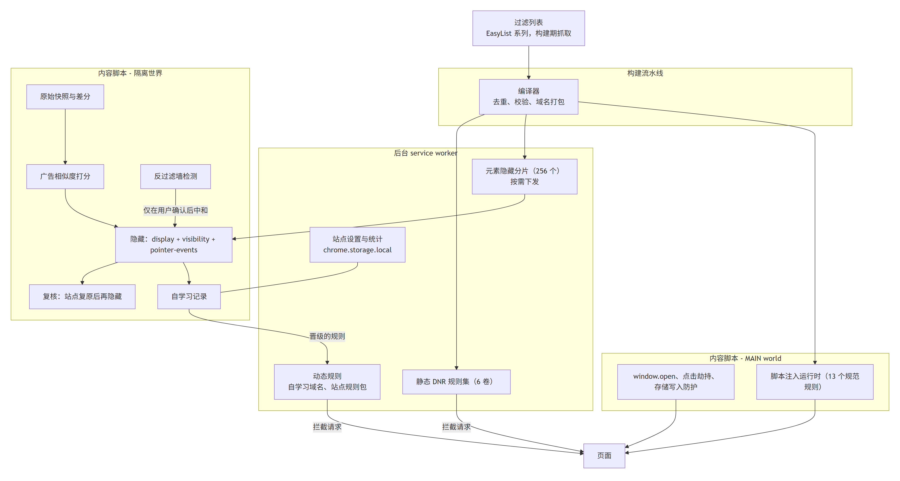
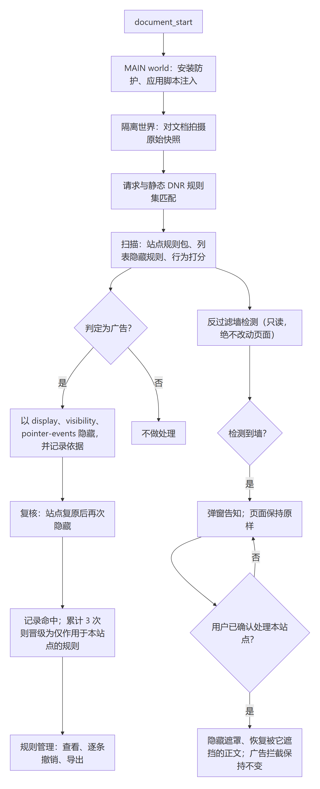

<div align="center">


# AdBlow

**在过滤列表匹配之外，依据页面运行时的元素行为判定并拦截广告。**

[](#)
[](#测试与验收)
[](#界面与本地化)

[English](README.md)

</div>

---

## 项目定位

AdBlow 是面向 Microsoft Edge 与 Google Chrome 的广告过滤扩展，基于 Manifest V3 开发。
过滤引擎、用户界面与构建工具链均为自行实现。

除 EasyList 系列过滤列表提供的规则匹配能力之外，扩展还包含一套运行时判定机制，逐元素评估
其行为特征，用于识别以下情形：由脚本注入页面、并非文档原有的浮层；素材来自全页仅出现一次的
域名；几何尺寸异常增长；链接经站点自有跳转接口中转；图片经 CDN 以 base64 路径代理。此类广告
一般不会出现在过滤列表中，但会留下可观测的行为特征。

## 设计取舍

**判定依据不限于过滤列表。** 常规方案以规则匹配请求与选择器，未命中列表的广告即被放行。
AdBlow 在此之外引入运行时观测，用于处理两类常见的规避手段：一是把广告链接改写为站点自有
域名下的跳转接口，其载荷中标注 `{"kind":"ad", ...}`；二是把素材的真实地址以 base64 编码
封装进站点自有 CDN 路径。两种情况均先还原出真实地址，再按真实地址判定。

**误伤的代价高于漏判。** 自学习产生的每条规则仅作用于产生该规则的站点，支持逐条撤销，且在
实现上不作用于图片、媒体、脚本与样式表。取舍标准如下：

> 宁可漏判，不可误伤。

与 AdBlock Plus 等产品不同，AdBlow 不设“可接受广告”付费白名单，不接受以付费方式放行广告；
构建脚本会拒绝拉取带付费白名单的列表。

## 架构



## 处理流程



## 与其他过滤器的对比

下表只列出与本项目定位相关的维度，**不是完整评测**。AdBlock Plus、AdGuard、uBlock Origin 各有
本项目不及之处（AdGuard 的产品线广度、uBlock Origin 的过滤语法覆盖）。依据各产品公开文档整理
（2026-10）；若有出入，欢迎指正。

| | **AdBlow** | AdBlock Plus | AdGuard | uBlock Origin |
|---|---|---|---|---|
| EasyList 系过滤列表 | 支持 | 支持 | 支持（另有自有列表） | 支持 |
| 付费白名单（“可接受广告”） | **无** | **有，默认开启** | 无 | 无 |
| 按运行时行为判定，而不止比对列表 | **有**：跨站素材、几何突增、自家域名跳转解包、CDN base64 解包 | 无 | 无 | 无 |
| 按站点自学习，可逐条撤销，且只作用于教会它的站点 | **有** | 无 | 无 | 无 |
| 反过滤墙 | 检测到后**经用户确认**才中和，广告拦截保持不变 | 依赖过滤列表 | 依赖烦扰过滤器，自动处理 | 依赖烦扰过滤器与脚本注入，自动处理 |
| 过滤列表更新 | 随扩展版本（MV3 静态规则集） | 运行时更新 | 运行时更新 | 完整版运行时更新；MV3 版（uBO Lite）随版本 |
| 价格与许可 | 免费；项目 GPL-3.0，代码另提供 MIT | 免费（GPLv3） | 扩展免费，桌面版付费 | 免费（GPLv3） |

## 功能

### 网络层

6 份过滤列表（EasyList、EasyList China、EasyPrivacy、uBlock filters / privacy / badware）
编译为 declarativeNetRequest 规则集。12.7 万条输入规则经去重与校验后保留 20,913 条拦截规则
与 2,365 条例外规则，分为 6 卷；十万余个域名锚点归并为 114 条规则。

### 元素隐藏

25,467 条域名限定选择器覆盖 11,357 个域名，按哈希切分为 256 个分片，由内容脚本按需向后台
服务脚本请求。未使用 `web_accessible_resources`，可被探测的接口相应减少。

### 行为判定

以页面加载初期的原始快照为基准做差分，对每个元素计算广告相似度。判定依据包括脚本注入、跨站
链接与素材、跨站 iframe、尺寸突增、推广参数、三个置信档位的广告命名、全屏覆盖层、点击层、
伪造关闭按钮、链接农场等。命中后写入 `data-adblow-reason` 与 `data-adblow-why`，排查误伤时
可直接定位到触发机制与具体证据。

### 反劫持

在页面的 MAIN world 中限制四类行为：`window.open` 调用、点击劫持、弹窗状态写入
（`localStorage`、`sessionStorage`、`window.name`），以及文档级“仅执行跳转”的点击处理函数。

### 反过滤墙

站点用诱饵元素探测过滤器、再用“请关闭广告过滤器”一类遮罩挡住页面时，弹窗提供逐站处理入口。
用户确认之前不改变页面任何行为；确认后隐藏该遮罩、恢复被它遮挡的正文，并保持广告拦截不变，
因此页面恢复可读，广告不会被放回来。检测始终运行，所以即使尚未处理，弹窗也能报告本页出现过
反过滤墙。

### 脚本注入

支持 13 个规范 `##+js(...)` 规则（`abort-on-property-read`、`set-constant`、`json-prune`、
`abort-current-script`、`no-fetch-if`、`no-setTimeout-if` 等），覆盖 3,247 个域名。数据表内联于
脚本，确保在页面脚本执行之前生效。

### 自学习

按站点记录需要隐藏的选择器与广告域名，累计命中 3 次后转为生效状态。全部记录可在“规则管理”
中查看，支持逐条删除与整体导出为 JSON。

### 站点开关

弹窗提供当前站点的过滤开关。关闭时，该站点上已生效的自学习网络规则同时暂停。

### 界面与本地化

提供中文（简体，默认）、English、日本語、Français、Español 五种界面语言，按浏览器界面语言
自动切换。

### 隐私

全部处理均在本地完成，不含遥测、账号与远程配置；除浏览器更新扩展本身之外，不产生对外请求。

## 截图

| 弹窗：站点开关与实时统计 | 规则管理 |
|---|---|
|  |  |

## 安装

当前可从源码构建安装：

```bash
git clone <本仓库> && cd adblow
pnpm install
pnpm filters        # 拉取 6 份过滤列表（不入库，见「许可证」）
pnpm rulesets       # 编译为网络规则集、元素隐藏分片与脚本注入数据表
pnpm build          # 产出 dist/
```

随后在 `edge://extensions`（或 `chrome://extensions`）中启用开发者模式，选择“加载解压缩的
扩展”，指向 `dist/` 目录。

面向商店的发布包由 `pnpm package` 生成，当前版本为 `release/adblow-1.0.1-edge.zip`；v1.0.0 已在
Edge 加载项商店上架。

过滤列表是构建期抓取而非随仓库分发，因此构建需要能访问其上游站点。若上游被屏蔽或过慢，取列表
脚本会自动回退到镜像（托管在 GitHub 的列表走 jsDelivr，EasyList 走 adblockplus.org），并打印
实际使用的来源，无需手动干预。

## 构建与打包

```bash
pnpm test           # 694 项单元与集成测试，单进程内执行
pnpm typecheck      # tsc --noEmit
pnpm verify         # 构建 + 测试
pnpm icons          # 重新生成图标（16/32/48/128 与商店图标）
pnpm package        # 构建 + 审计 + 打包，产出 release/adblow-<版本>-edge.zip
pnpm update-lists   # 刷新过滤列表并整体重建：拉取 → 编译 → 构建 → 测试 → 打包
```

依赖 Node.js 24 及以上与 pnpm；生成图标与商店截图另需 Python 3 与 Pillow。

过滤列表在构建阶段编译进静态规则集，而 MV3 未提供远程替换静态规则集的接口，因此列表的时效
取决于发版频率：刷新列表即等同于发布一个新版本。规则管理页会显示内置列表的抓取日期，可用于
判断当前安装的版本所携带的规则是否过期。定期发版与运行时增量更新两条路线的取舍，以及实测
得到的配额数据，见[过滤列表的更新策略](docs/LIST-UPDATES.md)。

打包阶段会将 `dist/` 中的文件清单与 manifest 实际声明的资源逐项核对，剔除不属于产物的文件
（例如浏览器自动生成的 `_metadata/` 规则集索引缓存），最终输出 `manifest.json` 位于压缩包
根目录的 zip。若此时浏览器正加载 `dist/`，Windows 会锁定该目录；更换构建目录即可，无需结束
浏览器进程：

```bash
ADBLOW_DIST=dist-release pnpm package
```

## 项目结构

实现上分为四层，逐层收敛权限与作用范围：

| 层 | 运行位置 | 职责 | 存在原因 |
|---|---|---|---|
| **网络层** | `declarativeNetRequest` | 由过滤列表编译的静态规则集，以及自学习域名的动态规则 | 在请求发出之前完成拦截 |
| **元素隐藏** | 隔离世界 | 域名限定 CSS；判定命中的元素以内联 `!important` 隐藏 | 使不应渲染的内容不进入渲染流程 |
| **行为判定** | 隔离世界 | 原始快照差分、广告相似度计算、自学习 | 覆盖过滤列表尚未收录的广告 |
| **反劫持** | MAIN world | `window.open`、点击劫持、存储写入、事件监听器 | 阻止页面反向干扰过滤行为 |

```
src/
  background/      service worker：同步网络规则、下发元素隐藏分片、记录统计
  content/         元素隐藏与行为判定：引擎、判定逻辑、学习记录存储、站点设置
  inject/          反劫持：MAIN world 限制与脚本注入运行时
  engine/          与浏览器无关的纯逻辑：相似度计算、词表、几何、DNR、过滤列表编译器、
                   脚本注入解析、选择器泛化
  rules/sites/     手写站点规则包（逐站验证的选择器）
  ui/              弹窗、规则管理、多语言
tools/
  filters/         过滤列表拉取（带付费白名单的列表会被拒绝）
  build/           规则集、元素隐藏分片、脚本注入数据表生成；打包；图标生成
  e2e/             24 类真实浏览器验收；活站端到端
  release/         审计、zip 打包、商店截图生成
  diagnostics/     可在控制台直接执行的诊断脚本，用于定位站点异常
tests/             694 项单元与集成测试（jsdom）
public/            manifest、_locales、图标
```

## 安全约束

以下约束均在代码中强制实现，并有对应测试覆盖。每一条都对应一次已发生的误伤事故：

- 自学习网络规则不作用于 `image`、`media`、`script`、`stylesheet`、`font`。内容缩略图与广告
  素材常共用同一 CDN，拦截将导致站点图片整体不可用。
- 自学习规则仅作用于产生该规则的站点（`initiatorDomains`）。在 A 站习得的域名不会影响 B 站。
- 隐式规则不拦截 `main_frame`，仅显式 `$document` 规则可拦截主文档。
- 不隐藏 `html`、`body`、`head`。隐藏三者等同于清空页面。
- 设有页级隐藏预算，限制可隐藏的正文与链接比例；含正文或导航的元素一律豁免。
- 隐藏同时设置 `display`、`visibility`、`pointer-events`，并在稍后复核。站点确会以自己的
  `!important` 重置 `display`，1024cg 一例即由复核发现。

## 测试与验收

```bash
node tests/run-all.ts           # 694 项测试，0 失败
node tools/e2e/acceptance.mjs   # 24 类广告，在真实浏览器中实测
```

`tools/e2e/acceptance.mjs` 是验收的主体。它为 24 类遮挡视线的广告各构造一个真实形态的页面，
覆盖前置弹窗、底层弹窗、插屏、随滚动漂浮、边角浮标、底部粘性横幅、页外流视频、前置贴片、
中插、视频叠加、整页可点击、伪造关闭按钮、点击劫持、标签页劫持、区域展开、闪烁 GIF、富媒体、
站点自有域名跳转包装、CDN base64 包装等。

每个夹具均测量两次。先关闭扩展测基线：若基线中该广告未构成遮挡，则判定夹具不合格，需重新
构造。再启用扩展测量：要求广告消失，且夹具正文仍可见。

另有活站端到端脚本 `tools/e2e/run.mjs <url>`，内置图片守卫、CDN 守卫与站点自有域名守卫。由此，
“修复某类广告却开始隐藏正文”这类回归会在测试阶段暴露，而不会进入发布版本。

## 已知限制

- 通用（非域名限定）元素隐藏规则未注入，仅注入域名限定的部分。
- 未实现过程式隐藏规则 `#?#` 与 HTML 过滤 `##^`。
- `abort-current-script` 仅在规则自带搜索串时生效：陷阱只中止源码命中搜索串的那个脚本，其余
  脚本读取时原样放行。列表中有 38 条没有搜索串，会被丢弃。仍未实现的脚本注入
  （`abort-on-stack-trace`、`remove-node-text`、`nano-setTimeout-booster`、`nowebrtc`、`noeval`
  等）合计 385 条。构建会如实报告跳过项，不会放宽规则以纳入更多条目。
- 反过滤墙（站点测量诱饵元素后对页面设门禁）只有在用户**逐站确认**之后才会处理。弹窗会提示并提供
  操作：隐藏该提示层、恢复被它遮挡的正文，同时广告拦截保持不变；用户确认之前不改变页面任何行为，
  确认后也可以随时撤销。
- 过滤列表在构建期编译，更新列表需重新构建扩展。此为 MV3 限制，不支持远程规则集。
- 尚无公开的性能基准，也尚未在中立站点上与其他过滤器做同条件对比。

## 第三方组件与许可

过滤列表由各自维护者维护，不属于本仓库，由构建阶段拉取：

| 列表 | 许可 |
|---|---|
| [EasyList](https://easylist.to/)、[EasyList China](https://easylist.to/)、[EasyPrivacy](https://easylist.to/) | GPL-3.0 / CC BY-SA 3.0 |
| [uBlock Origin assets](https://github.com/uBlockOrigin/uAssets)（filters、privacy、badware） | GPL-3.0 |

再分发由本仓库构建的任何交付物时，须遵守上述许可。

## 许可证

本项目整体按 **GPL-3.0** 分发，全文见 [LICENSE](LICENSE)；本仓库原创代码同时提供 **MIT**
授权，全文见 [LICENSE-MIT](LICENSE-MIT)，使用者可按 MIT 条款使用这些代码。

分层授权的原因：构建出的扩展会内嵌上表中 GPL-3.0 / CC BY-SA 的过滤列表数据，这部分无法按
MIT 授权，因此整个交付物按 GPL-3.0 分发；本仓库自行实现的代码（引擎、界面、构建与发布脚本、
测试）与之无关，额外提供 MIT 授权，便于复用。

第三方过滤列表不属于本仓库，由构建阶段拉取，各自的许可见上表。

---

<div align="center">
<sub>AdBlow 1.0.1 · Manifest V3 · Edge 与 Chrome</sub>
</div>
