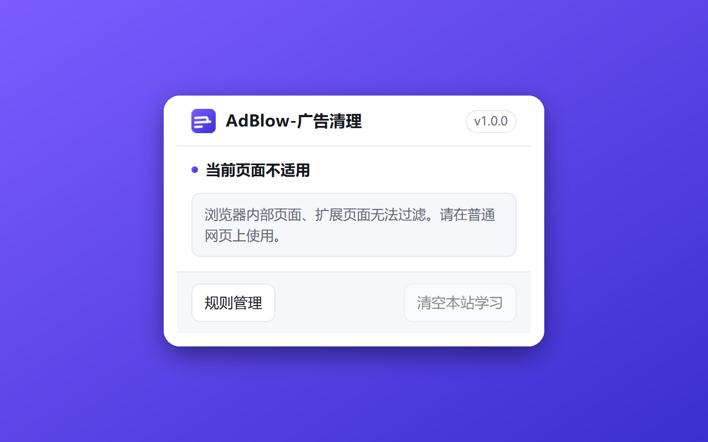
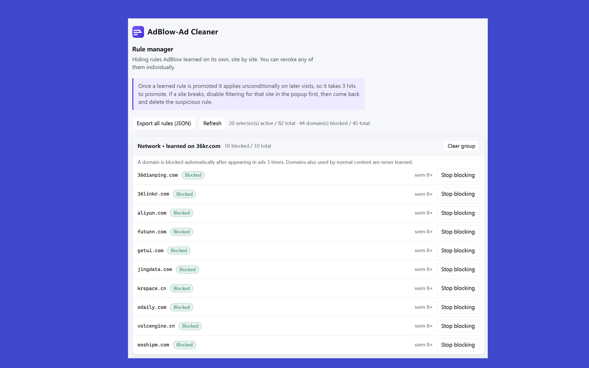

<div align="center">


# AdBlow

**判断一个元素是不是广告，不只看过滤列表，还看它在页面上怎么表现。**

[](#)
[](#测试与验收)
[](#界面与语言)

[English](README.md)

</div>

---

## AdBlow是什么

AdBlow是给Edge和Chrome用的广告过滤器，Manifest V3 扩展，引擎和界面都是自己写的。

它内置 EasyList 这一系的过滤列表，另外还有一套独立的运行时判据：在页面里逐个元素衡量
“它表现得更像广告，还是更像内容”。被脚本注入进页面的浮层、素材来自整页只出现一次的域名、
尺寸自己往大里长、链接被包进站点自家的跳转端点、图片藏在 CDN 的 base64 代理后面——这些
列表往往抓不到，但行为上藏不住。

## 和别的过滤器有什么不同

主要有两点。

**第一，判据不只有列表。** 多数过滤器做的事是拿规则去匹配请求和选择器，列表里没有的就放
过去了。AdBlow 还会看页面实际发生了什么，因此能处理两类常见的规避手法。一类是把广告链接
写成自家域名下的跳转接口，载荷里其实明写着 `{"kind":"ad", ...}`；另一类是把素材的真实地址
用 base64 包进自家 CDN 路径。这两种我们都会先解开，再按真实地址判定。

**第二，判断错了也不能把页面弄坏。** 自学习出来的每条规则都只作用于教会它的那个站点，
可以逐条撤销，而且在结构上不可能碰到图片、视频、样式和脚本。这里的取舍很明确：

> 宁可漏掉一个广告，也不弄坏页面。

还有一处不同：AdBlock Plus 有“可接受广告”付费白名单，交钱就能不被拦；AdBlow 没有这个东西，
构建脚本也会拒绝抓取带付费白名单的列表。

## 功能

### 网络层

6 份过滤列表（EasyList、EasyList China、EasyPrivacy、uBlock filters / privacy / badware）
编译成 declarativeNetRequest 规则集。12.7 万条输入规则经过去重与校验，留下 21,146 条拦截
规则和 2,369 条例外，分成 6 卷；十万多个域名锚点折叠成 113 条打包规则。

### 元素隐藏

25,478 条域名限定选择器覆盖 11,389 个域名，切成 256 个哈希分片，内容脚本按需向后台取用。
不走 `web_accessible_resources`，少一个可以被探测的接口。

### 行为判据

拿页面加载初期的原始快照做差分，再给每个元素打一个广告相似度。证据包括脚本注入、跨站链接
与素材、跨站 iframe、尺寸突增、推广参数、三档置信度的广告命名、全屏覆盖层、点击层、
假关闭按钮、链接农场等。命中后会写入 `data-adblow-reason` 和 `data-adblow-why`，排查误杀时
能直接看出是哪个机制、凭哪条证据动的手。

### 反劫持

在页面的 MAIN world 里守四件事：`window.open` 调用、点击劫持、弹窗状态清理
（`localStorage`、`sessionStorage`、`window.name`），以及文档级“只做跳转”的点击处理函数。

### 脚本注入

支持 12 个规范的 `##+js(...)` 规则（`abort-on-property-read`、`set-constant`、`json-prune`、
`no-fetch-if`、`no-setTimeout-if` 等），覆盖 2,841 个域名。数据表内联在脚本里，保证在页面
脚本之前执行完。

### 自学习

按站点记住需要隐藏的选择器和广告域名，累计命中 3 次才晋级生效。所有条目都能在“规则管理”
里看到，可以逐条删除，也可以整体导出成 JSON。

### 站点开关

弹窗里可以关掉当前站点的过滤，同时暂停该站点学到的网络规则。任何情况下都留一条退路。

### 界面与语言

中文（简体，默认）、English、日本語、Français、Español，跟随浏览器界面语言自动切换。

### 隐私

全部在本地完成。没有遥测、没有账号、没有远程配置；唯一的外发请求是浏览器更新扩展本身。

## 截图

| 弹窗：站点开关与实时统计 | 规则管理 |
|---|---|
|  |  |

## 安装

目前可以从源码安装：

```bash
git clone <本仓库> && cd adblow
pnpm install
pnpm filters        # 抓取 6 份过滤列表（不入库，见「许可」）
pnpm rulesets       # 编译成网络规则集、元素隐藏分片、脚本注入数据表
pnpm build          # 产出 dist/
```

然后打开 `edge://extensions`（或 `chrome://extensions`），打开右上角的“开发人员模式”，
点“加载解压缩的扩展”，选中 `dist/` 目录。

面向商店的发布包 `adblow-1.0.0-edge.zip` 已经准备好，但还没有上架。

## 构建与打包

```bash
pnpm test           # 631 项单元与集成测试，在单进程里跑完
pnpm typecheck      # tsc --noEmit
pnpm verify         # 构建 + 测试
pnpm icons          # 重新生成图标（16/32/48/128 以及商店图标）
pnpm package        # 构建 + 审计 + 打包，产出 release/adblow-<版本>-edge.zip
```

需要 Node.js 24 以上和 pnpm；生成图标与商店截图时还要用到 Python 3 和 Pillow。

打包时会拿 `dist/` 里的文件清单跟 manifest 实际声明的内容逐一核对，不属于产物的文件会被
剔除（例如浏览器自己生成的 `_metadata/` 规则集索引缓存），最后输出 `manifest.json` 位于
压缩包根目录的 zip。如果这时浏览器正加载着 `dist/`，Windows 会锁住这个目录，换个目录构建
就行，不用去杀浏览器进程：

```bash
ADBLOW_DIST=dist-release pnpm package
```

## 项目结构

设计上分四层，越往下越保守：

| 层 | 运行位置 | 做什么 | 为什么需要 |
|---|---|---|---|
| **网络层** | `declarativeNetRequest` | 过滤列表编译出的静态规则集，加上自学习域名的动态规则 | 请求还没发出去就被拦掉 |
| **元素隐藏** | 隔离世界 | 域名限定的 CSS；判定命中的元素再用内联 `!important` 隐藏 | 本就不该渲染的东西不渲染 |
| **行为判据** | 隔离世界 | 原始快照差分、广告相似度打分、自学习 | 抓列表没见过的东西 |
| **反劫持** | MAIN world | `window.open`、点击劫持、存储清理、监听器拒绝 | 不让页面反过来对付我们 |

```
src/
  background/      service worker：同步网络规则、下发隐藏分片、记录统计
  content/         元素隐藏与行为判据：引擎、判定、学习存储、站点设置
  inject/          反劫持：MAIN world 防护、脚本注入运行时
  engine/          纯逻辑，不依赖浏览器：打分、词表、几何、DNR、过滤列表编译器、
                   脚本注入解析、选择器泛化
  rules/sites/     手写站点规则包（逐站验证过的选择器）
  ui/              弹窗、规则管理、多语言
tools/
  filters/         抓取过滤列表（带付费白名单的会被拒绝）
  build/           生成规则集、隐藏分片、脚本注入数据表；打包；生成图标
  e2e/             23 类真实浏览器验收；活站端到端
  release/         审计、打 zip、生成商店截图
  diagnostics/     可直接粘进控制台的诊断脚本，用来查某个站点被弄坏的原因
tests/             631 项单元与集成测试（jsdom）
public/            manifest、_locales、图标
```

## 安全底线

下面每一条都写进了代码，也有测试守着。它们之所以存在，是因为每一条都对应一次真实的失误：

- 自学习出的网络规则绝不拦 `image`、`media`、`script`、`stylesheet`、`font`。内容缩略图和
  广告素材常常共用同一个 CDN，拦下去就是整站图片不显示。
- 自学习规则只作用于教会它的站点（`initiatorDomains`）。在 A 站学到的域名，不会影响 B 站。
- 隐式规则永远不拦 `main_frame`，只有显式的 `$document` 规则可以。
- 绝不隐藏 `html`、`body`、`head`。隐藏它们等于把整页清空。
- 有页级隐藏预算，限制能隐藏的正文与链接比例；装着正文或导航的元素一律豁免。
- 隐藏会同时设上 `display`、`visibility`、`pointer-events` 三道，之后还会复核一次。站点确实
  会用自己的 `!important` 把 `display` 改回来，1024cg 那次就是靠复核才发现的。

## 测试与验收

```bash
node tests/run-all.ts           # 631 项测试，0 失败
node tools/e2e/acceptance.mjs   # 23 类广告，在真实浏览器里实测
```

`tools/e2e/acceptance.mjs` 是重点。它为 23 类干扰视线的广告各准备了一个真实形态的页面：
前置弹窗、底层弹窗、插屏、跟随滚动漂浮、边角浮标、底部粘性横幅、页外流视频、前置贴片、
中插、视频叠加、整页可点击、假关闭按钮、点击劫持、标签页劫持、区域展开、闪烁 GIF、
富媒体、自家域名跳转包装、CDN base64 包装等等。

每个夹具都要测两遍。先关掉扩展测基线：如果基线里它压根不干扰视线，这个夹具就算不合格，
要重做。再打开扩展测一遍：广告必须消失，同时夹具里的正文必须仍然可见。

另有一个活站端到端脚本 `tools/e2e/run.mjs <url>`，带图片守卫、CDN 守卫和站点自有域名守卫。
所以“修好了一个广告，却开始隐藏正文”这类回归会立刻失败，而不是悄悄上线。

## 目前还不支持

- 通用（不带域名限定）的元素隐藏规则没有注入，只注入域名限定的那部分。
- 过程式隐藏规则 `#?#` 和 HTML 过滤 `##^` 没有实现。
- `##+js(abort-current-script)` 等少数脚本注入规则不支持（列表里有 359 条）。构建会如实
  报告跳过了什么，而不是把规则悄悄放宽。
- 过滤列表在构建时编译，要换列表就得重新构建扩展。这是 MV3 的限制，不支持远程规则集。
- 还没有公开的性能基准，也还没有拿中立站点和其他过滤器做过公平对比。

## 致谢

过滤列表是各自维护者的成果，不在本仓库里，构建时抓取：

| 列表 | 许可 |
|---|---|
| [EasyList](https://easylist.to/)、[EasyList China](https://easylist.to/)、[EasyPrivacy](https://easylist.to/) | GPLv3 / CC BY-SA 3.0 |
| [uBlock Origin assets](https://github.com/uBlockOrigin/uAssets)（filters、privacy、badware） | GPLv3 |

再分发由本仓库构建出来的任何东西时，请遵守上述许可。

## 许可


1. **整个项目用 GPL-3.0。** 考虑到内嵌的列表，这是最容易讲清楚的一种。
2. **代码用 MIT 或 Apache-2.0**，同时明确声明构建产物内嵌第三方的 GPL / CC BY-SA 数据，
   并继承相应的义务。


---

<div align="center">
<sub>AdBlow 1.0.0 · Manifest V3 · Edge 与 Chrome</sub>
</div>
